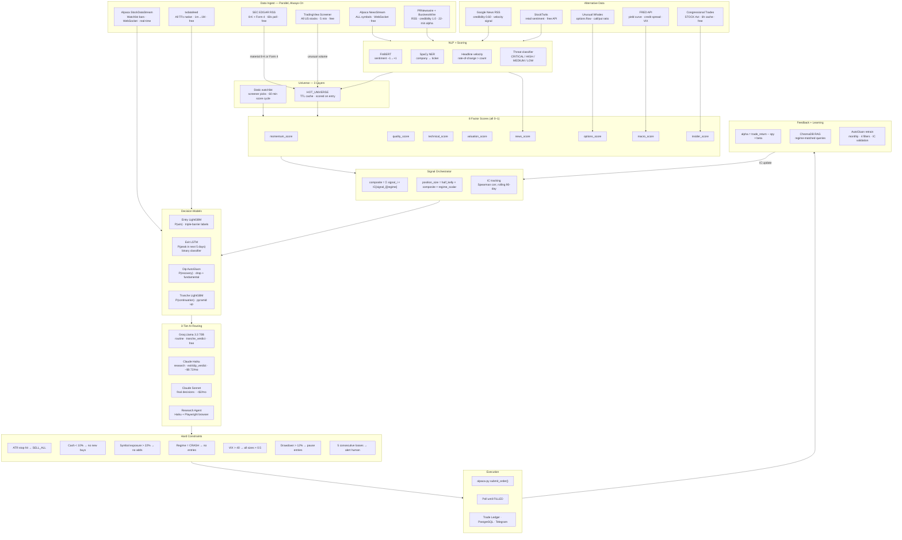
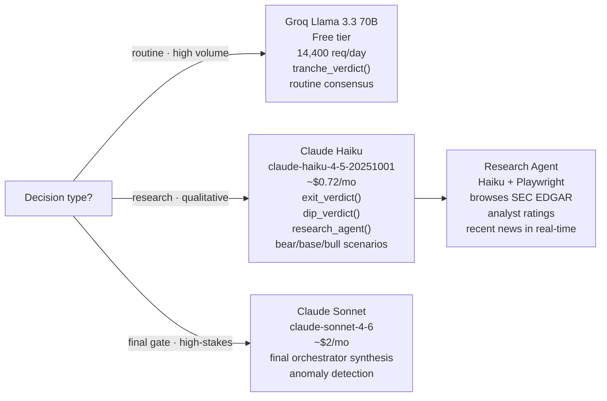
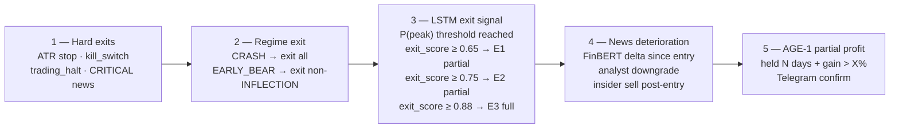
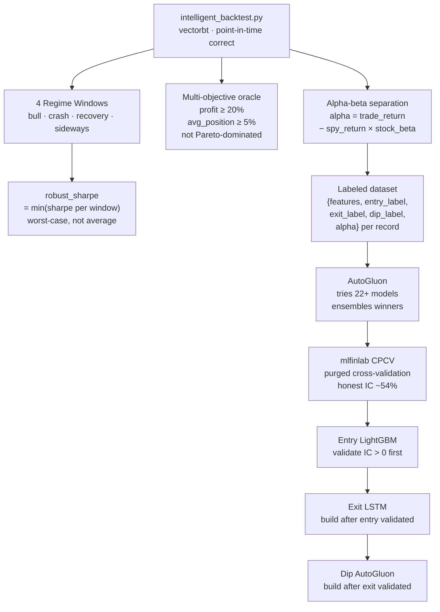

# trading-system-v2

Private algorithmic trading system. Personal use on private VPS only. AGPL-3.0.

## What it does

A fully automated equity trading pipeline built on the **scores-not-gates** philosophy:
every signal contributes a weighted score that drives position SIZE — no signal blocks a trade.
Only 2 hard gates: CRASH regime and cash reserve < 10%.

1. **Universe discovery** — 4 parallel methods: knowledge graph (SEC 10-K supply-chain), theme baskets (10 ETF-expanded baskets), momentum expansion (>40% 3m return), user seeds
2. **8-factor scoring** — momentum, quality, technical, valuation, news, options flow, macro, insider — all 0–1 normalised, IC-weighted per regime
3. **Composite signal** — `Σ(signal_i × IC[signal_i][regime])` → position size via half-Kelly; no gates
4. **3-model decision stack** — entry (LightGBM/AutoGluon), exit (LSTM binary classifier P(peak)), dip (AutoGluon)
5. **Tranche management** — T1 (33%) → T2 price confirm → T3 new high; dip tranches accumulate on fundamental dips
6. **3-tier AI routing** — Groq Llama 3.3 (routine/free) → Claude Haiku (research ~$0.72/mo) → Claude Sonnet (final decisions ~$2/mo)
7. **Alpha-beta separation** — every stored outcome records `alpha = trade_return − (spy_return × stock_beta)`; models learn edge, not bull-market luck
8. **Multi-regime oracle** — `robust_sharpe = min(sharpe across 4 regime windows)`; strategies that collapse in crash score low
9. **Intelligent backtester** — vectorbt-based, point-in-time correct, alpha-beta separated, multi-objective oracle
10. **Feedback loop** — daily top-mover collection, ChromaDB RAG (regime-matched queries), monthly AutoGluon retrain
11. **Terminal** — Bloomberg-style research terminal with TradingView charts, 9 TF buttons, 11 tabs (Analysis / Earnings / Financials / Holdings), 2 position panels

## Quick start

```bash
cp .env.example .env           # fill in API keys
./venv/Scripts/activate        # Windows  (Linux: source venv/bin/activate)
pip install -r requirements.txt
python -m spacy download en_core_web_sm
alembic upgrade head
python run_server.py           # → http://localhost:8000/dashboard
```

Key env vars: `ALPACA_API_KEY`, `ALPACA_API_SECRET`, `GROQ_API_KEY` (free), `ANTHROPIC_API_KEY`,
`FRED_API_KEY` (free at fred.stlouisfed.org), `DATABASE_URL`, `TELEGRAM_BOT_TOKEN`, `TELEGRAM_CHAT_ID`

---

## Architecture Overview

### Full Signal Flow (v13)



### Scores-not-Gates: Position Sizing

```mermaid
flowchart LR
    S["8 factor scores\n+ regime IC weights"]
    C["composite_score\n= Σ signal_i × IC[signal_i][regime]"]
    K["half_kelly × composite\n× regime_scalar"]
    T1["Tranche 1 (33%)\ncomposite ≥ 0.35"]
    T2["Tranche 2 (+33%)\nprice confirms 1.5×ATR"]
    T3["Tranche 3 (+34%)\nnew high + composite ≥ regime_threshold"]
    DIP["Dip Tranche (0.8–1.5× T1)\ndip_score ≥ 0.65 + thesis intact"]

    S --> C --> K --> T1
    K --> T2
    K --> T3
    K --> DIP

    style T1 fill:#1a1a28,stroke:#6366f1
    style T2 fill:#1a1a28,stroke:#6366f1
    style T3 fill:#1a1a28,stroke:#6366f1
    style DIP fill:#1a1a28,stroke:#fbbf24
```



### 3-Tier AI Routing



### Exit Priority



### Backtester + Training Pipeline



---

## Repository Structure

```
trading-system-v2/
│
├── README.md                          ← this file
├── PLAN.md                            ← session restart guide
├── requirements.txt
├── config.json                        ← all runtime config
├── .env.example                       ← environment variable template
├── database.py                        ← SQLAlchemy models
├── run_server.py                      ← entry point
│
├── backtester/
│   └── intelligent_backtest.py        ← vectorbt · alpha-beta · multi-regime oracle
│
├── data/
│   ├── cache_manager.py               ← 8-layer TTL cache
│   ├── edgar_monitor.py               ← SEC EDGAR 8-K + Form 4 RSS
│   ├── feedback_loop.py               ← daily mover · alpha-beta labels · regime RAG
│   ├── fetcher.py                     ← OHLCV (yfinance + alpaca fallback)
│   ├── fundamentals_fetcher.py        ← EDGAR XBRL primary, FMP fallback
│   ├── hot_universe.py                ← TTL cache for event-driven symbols
│   ├── knowledge_graph.py             ← NetworkX SEC 10-K supply-chain graph
│   ├── model_updater.py               ← monthly AutoGluon retrain
│   ├── news_aggregator.py             ← 39-source RSS + NLP pipeline
│   ├── news_relevance_engine.py       ← SpaCy NER → company → ticker
│   ├── news_sources.py                ← 39-source Tier 1/2/3 registry
│   ├── news_stream.py                 ← Alpaca NewsDataStream WebSocket
│   ├── price_stream.py                ← Alpaca StockDataStream WebSocket
│   ├── screener.py                    ← 8 factor scores (0–1) + universe builder
│   ├── tv_screener.py                 ← TradingView Screener (free, all US stocks)
│   │
│   ├── fincept/
│   │   ├── agents/
│   │   │   └── research_agent.py      ← Claude Haiku + Playwright browser agent
│   │   ├── congressional_trades.py    ← STOCK Act (House+Senate) · 6h cache · free
│   │   ├── google_news.py             ← Google News RSS · credibility 0.60
│   │   └── yfinance_data.py           ← quotes · earnings · financials · holdings
│   │
│   ├── notifications/
│   │   ├── alerts.py                  ← alert type constants
│   │   └── telegram.py                ← Telegram bot · rate-limited · all alert types
│   │
│   └── sources/
│       ├── alpaca_feed.py             ← free real-time US stock data (our broker)
│       ├── base_source.py             ← SourceWithFallback base class
│       ├── browser_scraper.py         ← Playwright base class
│       ├── businesswire.py            ← BusinessWire RSS · credibility 1.0
│       ├── earnings_whispers.py       ← whisper numbers · Playwright + RSS fallback
│       ├── fred_macro.py              ← FRED API · yield curve · credit spread · VIX
│       ├── pattern_detector.py        ← algebraic pattern detection (replaces YOLOv8)
│       ├── prnewswire.py              ← PRNewswire RSS · credibility 1.0 · 22-min edge
│       ├── seeking_alpha.py           ← headlines · Playwright + Google News fallback
│       ├── stocktwits.py              ← retail sentiment · free public API
│       ├── tvdatafeed_client.py       ← all TFs native (1m→1M) · no resampling needed
│       └── unusual_whales.py          ← options flow · Playwright + Barchart fallback
│
├── strategy/
│   ├── chart_pattern_detector.py      ← YOLOv8 legacy (kept, replaced by pattern_detector)
│   ├── config_loader.py               ← typed config.json loader
│   ├── consensus.py                   ← 3-tier AI routing · exit/dip/tranche verdicts
│   ├── correlation_risk.py            ← portfolio correlation checks
│   ├── dip_detector.py                ← AutoGluon dip model + dip_verdict()
│   ├── exit_monitor.py                ← LSTM P(peak) classifier + exit_verdict()
│   ├── holding_tier.py                ← T1/T2/T3 tier classification
│   ├── macro_analyser.py              ← VIX + yield spread + FRED + Fear&Greed
│   ├── meta_model.py                  ← LightGBM wrapper · save/load · walk-forward CV
│   ├── news_sentiment.py              ← FinBERT wrapper (yiyanghkust/finbert-tone)
│   ├── options_selector.py            ← long call · protective put · covered call
│   ├── pattern_api.py                 ← chart pattern inference wrapper
│   ├── position_aging.py              ← AGE-1 partial profit logic
│   ├── position_manager.py            ← entry/exit · tranche wiring · portfolio risk controls
│   ├── regime_detector.py             ← 8-state regime detection
│   ├── scorer.py                      ← feature vector builder (~138 features)
│   ├── signal_basket.py               ← entry/exit basket computation (27 signals)
│   ├── signal_orchestrator.py         ← composite scoring · IC weighting · meta-stacking · Claude Sonnet gate
│   ├── technical_analysis.py          ← pandas-ta 130+ indicators + 60 CDL patterns
│   ├── threat_classifier.py           ← word-list NLP: CRITICAL/HIGH/MEDIUM/LOW
│   ├── trade_labels.py                ← trade outcome labeling (9 label types v13)
│   ├── trade_ledger.py                ← per-symbol markdown + master log
│   ├── trade_state.py                 ← in-memory position state
│   ├── tranche_manager.py             ← T1/T2/T3 + dip tranches · add-up vs add-down
│   ├── training_pipeline.py           ← AutoGluon + mlfinlab CPCV · entry model first
│   └── triple_barrier.py              ← TP/SL/time labeling (López de Prado)
│
├── server/
│   ├── api.py                         ← FastAPI · 40+ endpoints incl. analysis/earnings/financials/holdings
│   ├── alpaca_trader.py               ← alpaca-py · fill verification polling
│   ├── kill_switch.py                 ← emergency halt
│   ├── order_manager.py               ← order dedup + retry
│   ├── scheduler.py                   ← APScheduler orchestrator
│   └── telegram_alerts.py             ← Telegram bot notifications
│
├── dashboard/
│   ├── terminal.html                  ← Bloomberg-style terminal (TradingView widget, 11 tabs)
│   └── preview_terminal.html          ← static mock preview (v13 UI)
│
├── models/                            ← trained ML artifacts
│   └── .gitkeep
│
├── logs/
│   ├── trade_ledger/
│   ├── backtest_ledger/
│   └── performance/
│
└── tests/
    ├── conftest.py
    └── test_*.py                      ← pytest suite
```

---

## Build Phases

| Phase | Status | Description |
|-------|--------|-------------|
| **Phase 1** | ✅ Complete | Working live system: event-driven universe, 39-source news, signal basket wired, paper trading |
| **Phase 2** | ✅ Complete | YOLOv8 visual chart patterns (kept as legacy), feature vector builder, fundamentals fetcher |
| **Phase 3** | ✅ Complete | LightGBM meta-model: triple-barrier labeling, walk-forward CV, P(win) position sizing |
| **Phase 4** | ✅ Complete | Options: long calls, protective puts, covered calls |
| **Phase 5** | ✅ Complete | Wiring gaps, Alembic migrations, consensus fixes |
| **v13** | ✅ Complete | Scores-not-gates, alpha-beta separation, 3-tier AI, algebraic patterns, 14 new data sources, intelligent backtester, LSTM exit, dip detector, tranche manager, signal orchestrator, 4 new terminal tabs |

---

## News Credibility Hierarchy

| Source | Credibility | Why |
|--------|-------------|-----|
| PRNewswire | 1.0 | Direct from company — earliest, authoritative |
| BusinessWire | 1.0 | Direct from company — earliest, authoritative |
| SEC 8-K | 1.0 | Regulatory filing — material disclosure |
| Reuters | 0.85 | Tier 1 news agency |
| Benzinga | 0.75 | Financial news, fast |
| Seeking Alpha | 0.70 | Analyst opinions, delayed |
| Google News | 0.60 | Aggregated, undifferentiated |
| StockTwits | 0.40 | Retail sentiment — volume signal more useful than direction |
| Reddit | 0.30 | Retail noise |

Deduplication: cosine similarity > 0.85 = same story → keep highest-credibility source only.

---

## Data Sources (all free)

| Source | What | Key |
|--------|------|-----|
| tvdatafeed | OHLCV all timeframes (1m→1M) native | None |
| Alpaca | Real-time bars + news WebSocket | Free with account |
| PRNewswire RSS | Company press releases | None |
| BusinessWire RSS | Company press releases | None |
| SEC EDGAR JSON | Filings, Form 4 insider trades | None |
| FRED API | GDP, CPI, unemployment, yields, VIX | Free at fred.stlouisfed.org |
| Unusual Whales | Options flow via Playwright | None |
| Congressional trades | STOCK Act (CapitolTrades + Senate EFTS) | None |
| Google News RSS | Headline velocity signal | None |
| StockTwits | Retail sentiment | None (public API) |
| TradingView Screener | All 9000+ US stocks momentum scan | None |
| yfinance | Quote, financials, earnings, holders | None |

---

## Key Design Decisions (v13)

| Decision | Choice | Why |
|----------|--------|-----|
| Signal philosophy | Scores drive SIZE, not gates | Gates compound failure rates multiplicatively; P(trade) = 0.7^6 = 12% |
| AI routing | Groq → Haiku → Sonnet | Cost $3/mo total; Groq free for routine, Sonnet for decisions |
| Training labels | Alpha-adjusted triple barrier | Prevents learning bull-market bias as alpha |
| Backtesting oracle | robust_sharpe = min across 4 regime windows | Strategies that collapse in crash must fail oracle |
| Pattern detection | Algebraic (replaces YOLOv8) | Deterministic, no training data, transparent, no GPU |
| OHLCV source | tvdatafeed (primary) | 4H native — no server-side resampling; all 9 TFs |
| Exit model | LSTM binary classifier (not N-BEATS) | We ask "is this a peak?" (classification), not "what is next price?" (forecast) |
| Model validation | mlfinlab CPCV | Purged CV prevents financial data leakage; honest IC ~54% |
| News primary | PRNewswire + BusinessWire RSS | 22-minute alpha advantage over aggregators |
| Insider data | Congressional trades + Form 4 | Empirically highest IC of any alternative data |
| Fallback pattern | SourceWithFallback base class | All Playwright scrapers auto-fall to secondary; Telegram alert on degradation |

---

## Telegram Alert Types

```
⚠️  Source degradation    — unusual_whales down, using barchart fallback (1h cooldown)
🚨  Critical data gap      — source AND all fallbacks down, neutral default applied
🛑  Circuit breaker        — VIX > 40 / drawdown > 12% / 5 consecutive losses
💹  Trade execution        — ENTRY T1: NVDA @$142.50 | composite=0.74 | size=4.2%
💹  Trade exit             — EXIT E1: NVDA @$158.20 | +11.1% | alpha=+8.3%
ℹ️  Model retrain          — Entry model IC: 0.142 (+0.008). 847 new samples.
🟢  Daily health (09:00)   — Source status + portfolio summary + VIX + regime
🟢  Startup               — System started. VIX=18.4, 6 positions open.
```

---

## Git Workflow

- `main` is protected — no direct commits
- All work on feature branches: `feat/`, `fix/`, `chore/`, `docs/`
- Linear history: rebase, not merge commits

```bash
git checkout main && git pull --rebase
git checkout -b feat/your-feature
# ... commit ...
git rebase main
git push -u origin feat/your-feature
```
