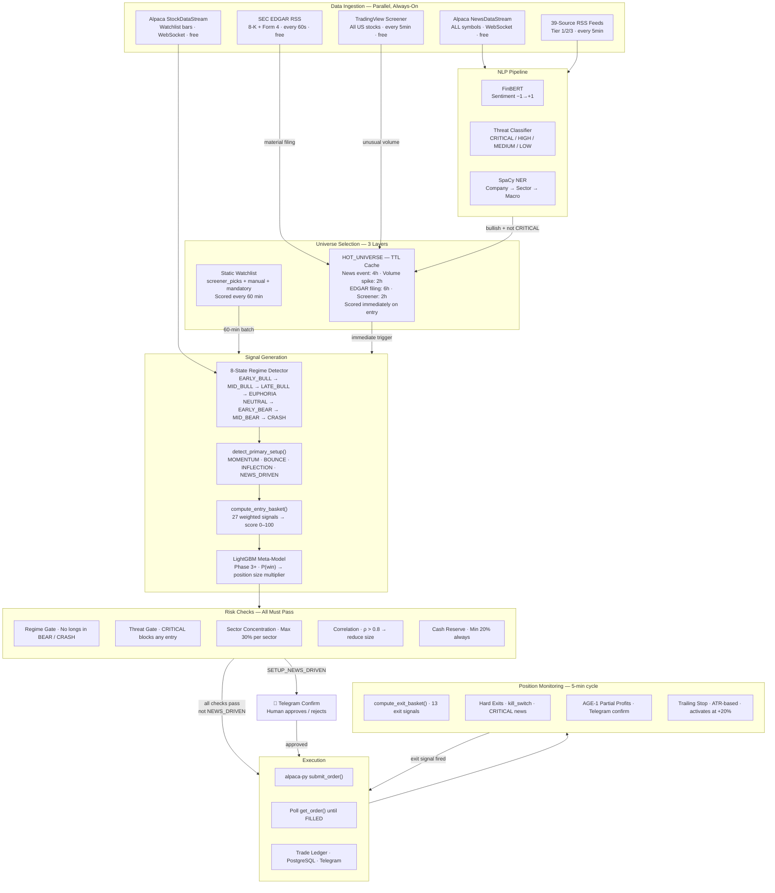
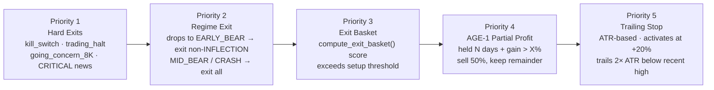
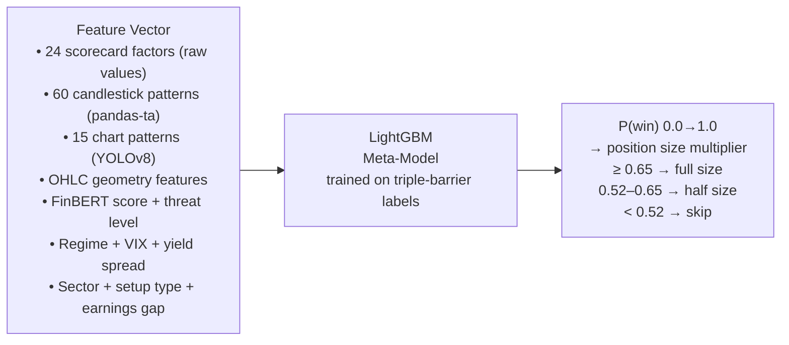

# trading-system-v2

An event-driven, ML-augmented US equity trading system built on Alpaca paper/live trading.
Greenfield rebuild of [TradingSystem](../TradingSystem) with a 3-layer universe, LightGBM
meta-model, 39-source news pipeline, and properly wired signal basket.

---

## Architecture Overview

### Full Data & Signal Flow



### Exit Priority Order



### LightGBM Meta-Model (Phase 3+)



---

## Repository Structure

```
trading-system-v2/
│
├── README.md                        ← this file — architecture + flowcharts
├── PLAN.md                          ← SESSION RESTART GUIDE — read this in new chats
├── requirements.txt                 ← all Python dependencies
├── config.json                      ← all runtime config (no hardcoded values in code)
├── .env.example                     ← environment variable template
├── .gitignore
├── database.py                      ← SQLAlchemy models + async engine
├── run_server.py                    ← entry point: starts FastAPI + APScheduler
│
├── data/                            ← all data ingestion and caching
│   ├── __init__.py
│   ├── cache_manager.py             ← 8-layer TTL cache, atomic JSON writes
│   ├── fetcher.py                   ← OHLCV via yfinance + alpaca-py bars
│   ├── fundamentals_fetcher.py      ← sec-edgar-api primary, FMP fallback
│   ├── hot_universe.py              ← TTL cache for event-driven symbol discovery
│   ├── news_sources.py              ← 39-source registry (Tier 1 / 2 / 3)
│   ├── news_aggregator.py           ← RSS fetch + dedup + NLP pipeline trigger
│   ├── news_relevance_engine.py     ← SpaCy NER → sector → macro causal rules
│   ├── news_stream.py               ← Alpaca NewsDataStream("*") WebSocket
│   ├── edgar_monitor.py             ← SEC EDGAR 8-K + Form 4 RSS polling
│   ├── tv_screener.py               ← TradingView Screener (MIT, no API key)
│   └── price_stream.py              ← Alpaca StockDataStream WebSocket
│
├── strategy/                        ← signal generation, risk, ML model
│   ├── __init__.py
│   ├── signal_basket.py             ← [COPIED] entry/exit basket computation
│   ├── signal_types.py              ← [COPIED] SetupType enum + constants
│   ├── regime_detector.py           ← [COPIED] 8-state regime detection
│   ├── trade_ledger.py              ← [COPIED] per-symbol markdown + master log
│   ├── position_aging.py            ← [COPIED] AGE-1 partial profit logic
│   ├── correlation_risk.py          ← [COPIED] portfolio correlation checks
│   ├── holding_tier.py              ← [COPIED] T1/T2/T3 tier classification
│   ├── trade_state.py               ← [COPIED] in-memory position state
│   ├── trade_labels.py              ← [COPIED] trade outcome labeling
│   ├── config_loader.py             ← [COPIED] typed config.json loader
│   ├── technical_analysis.py        ← pandas-ta indicators + candlestick patterns
│   ├── threat_classifier.py         ← word-list NLP: CRITICAL/HIGH/MEDIUM/LOW
│   ├── news_sentiment.py            ← FinBERT wrapper (yiyanghkust/finbert-tone)
│   ├── macro_analyser.py            ← VIX + yield curve + FRED + Fear&Greed
│   ├── position_manager.py          ← entry/exit logic with signal basket WIRED
│   ├── scorer.py                    ← feature vector builder (input to LightGBM)
│   ├── meta_model.py                ← LightGBM wrapper — Phase 3+
│   ├── triple_barrier.py            ← training label generation — Phase 3+
│   ├── screener_guardrails.py       ← [COPIED] fundamental quality filters
│   └── performance_calculator.py   ← quantstats wrapper
│
├── server/                          ← API, scheduling, broker
│   ├── __init__.py
│   ├── api.py                       ← FastAPI routes
│   ├── scheduler.py                 ← APScheduler orchestrator (replaces schedule lib)
│   ├── alpaca_trader.py             ← alpaca-py broker client + fill verification
│   ├── order_manager.py             ← order dedup + retry logic
│   ├── kill_switch.py               ← emergency halt
│   └── telegram_alerts.py          ← Telegram bot notifications
│
├── models/                          ← trained ML model artifacts (Phase 3+)
│   └── .gitkeep
│
├── logs/                            ← trade ledger, backtest results, performance
│   ├── trade_ledger/
│   ├── backtest_ledger/
│   └── performance/
│
└── tests/                           ← pytest test suite
    ├── conftest.py
    ├── test_signal_basket.py        ← [PORTED from TradingSystem]
    ├── test_regime_detector.py      ← [PORTED]
    ├── test_threat_classifier.py    ← new
    ├── test_hot_universe.py         ← new
    └── test_technical_analysis.py  ← new
```

---

## Build Phases

| Phase | Status | Description |
|-------|--------|-------------|
| **Phase 1** | 🔨 In Progress | Working live system: event-driven universe, 39-source news, signal basket wired, paper trading |
| **Phase 2** | ⏳ Pending | Candlestick patterns: pandas-ta rule-based + YOLOv8 visual chart pattern detection |
| **Phase 3** | ⏳ Pending | LightGBM meta-model: triple-barrier labeling, walk-forward training via PyBroker |
| **Phase 4** | ⏳ Pending | Options expansion via alpaca-py OptionDataStream + Qlib IC factor validation |

---

## Setup

```bash
# 1. Clone and install
git clone https://github.com/bangalore-killua/trading-system-v2.git
cd trading-system-v2
pip install -r requirements.txt
python -m spacy download en_core_web_sm

# 2. Configure environment
cp .env.example .env
# Edit .env with your Alpaca API keys, DB URL, Telegram token

# 3. Set up database
createdb trading_system_v2
python -c "from database import create_tables; create_tables()"

# 4. Run (paper trading by default)
python run_server.py
```

---

## Git Workflow

- `main` branch is protected — no direct commits
- All work on feature branches: `feat/`, `fix/`, `chore/`
- Linear history: use rebase, not merge commits
- PR required to merge into main

```bash
# Start new work
git checkout main && git pull --rebase
git checkout -b feat/your-feature-name

# Commit often with descriptive messages
git add -p
git commit -m "feat(data): add EDGAR Form 4 RSS monitor for insider buying"

# Rebase before PR
git rebase main

# Push and open PR
git push -u origin feat/your-feature-name
```

---

## Key Design Decisions

| Decision | Choice | Why |
|----------|--------|-----|
| Broker | Alpaca | Paper + live, free, supports options |
| Signal direction | Rule-based signal basket | Auditable, backtestable, deterministic |
| Bet sizing | LightGBM meta-model | Learns which conditions actually predict wins |
| Training labels | Triple barrier (TP/SL/time) | Matches real trade outcomes, not naive forward return |
| Universe discovery | WebSocket + RSS (not polling 9000 stocks) | Free tier compatible, event-driven |
| Scheduler | APScheduler | PostgreSQL job store, asyncio, persistent across reboots |
| Technical indicators | pandas-ta | 130+ indicators, MIT, pure Python, no C library |
| News NLP | FinBERT + word-list threat classifier | FinBERT for sentiment, word-list for speed on threat triage |
| SETUP_NEWS_DRIVEN | Never auto-execute | Human Telegram confirm required — too volatile |
