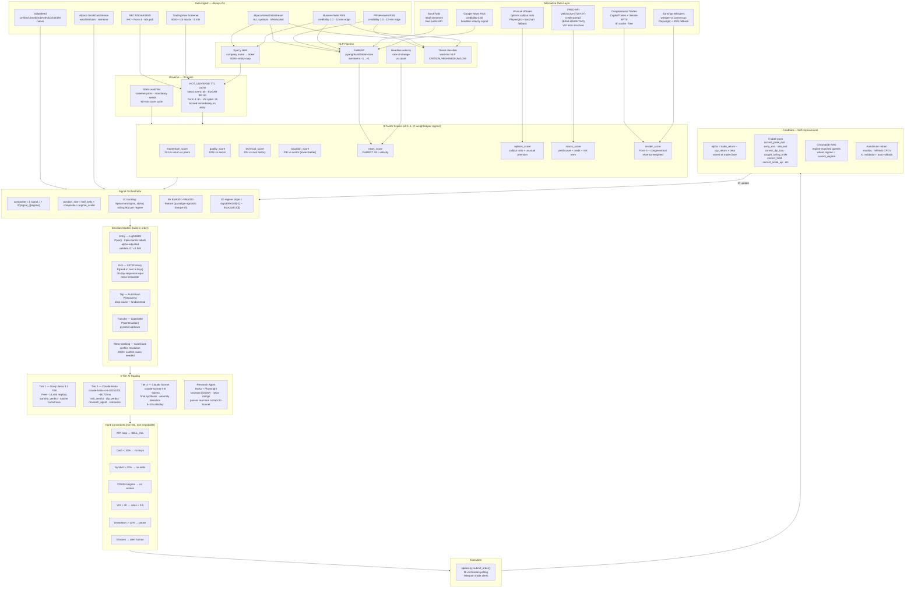
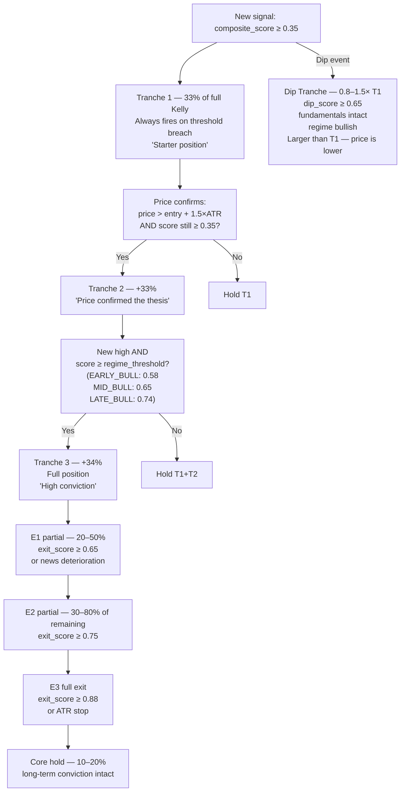
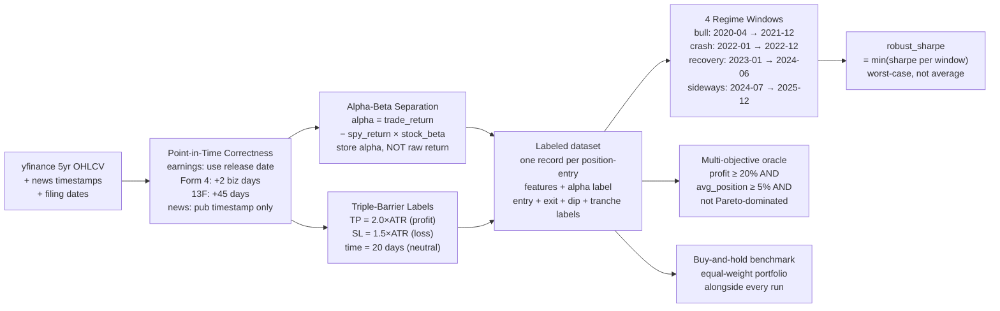
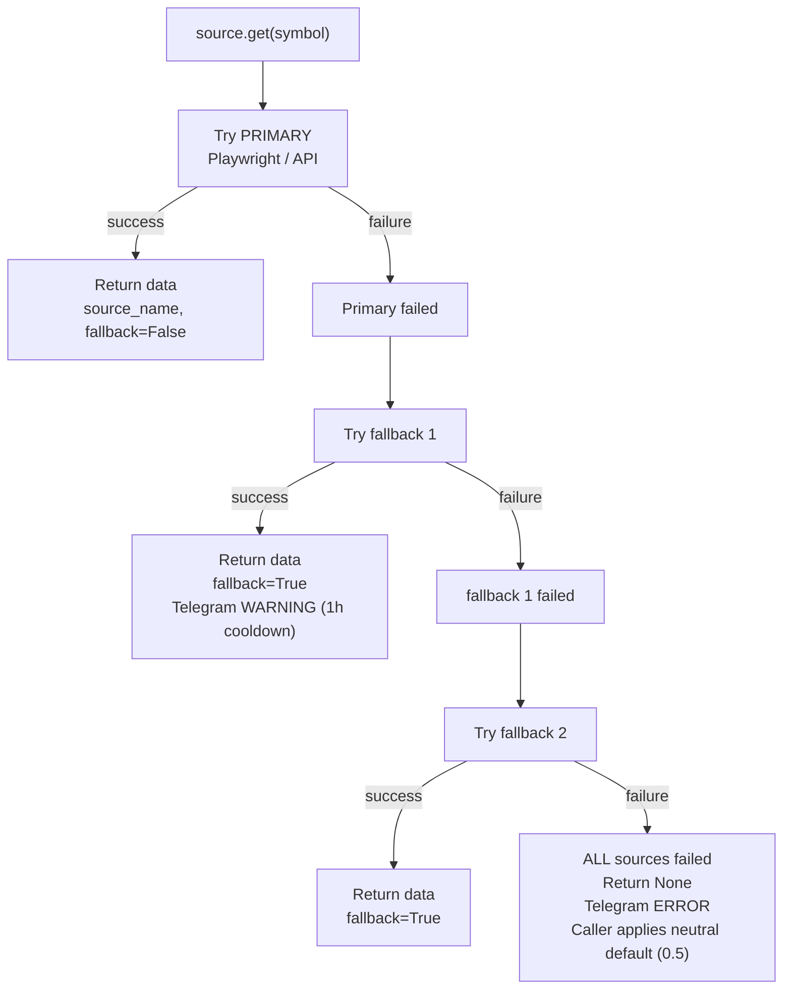

# System Architecture (v13)

## Full Signal Pipeline

---

## Tranche Management

---

## Intelligent Backtester

---

## SourceWithFallback — Graceful Degradation

---

## Component Map (v13)

| Component | File | Role |
|-----------|------|------|
| Signal orchestrator | `strategy/signal_orchestrator.py` | Composite scoring · IC weighting · meta-stacking · Claude Sonnet |
| Exit monitor | `strategy/exit_monitor.py` | LSTM P(peak) binary classifier |
| Dip detector | `strategy/dip_detector.py` | AutoGluon P(recovery) + dip_verdict() |
| Tranche manager | `strategy/tranche_manager.py` | T1/T2/T3 + dip tranches |
| Consensus engine | `strategy/consensus.py` | 3-tier AI routing + verdict dispatch |
| Position manager | `strategy/position_manager.py` | Half-Kelly sizing · ATR stops · portfolio risk |
| Pattern detector | `data/sources/pattern_detector.py` | Algebraic · 12 patterns · no model file |
| Options flow | `data/sources/unusual_whales.py` | Playwright + Barchart fallback |
| FRED macro | `data/sources/fred_macro.py` | Yield curve · credit spread · VIX |
| Congressional | `data/fincept/congressional_trades.py` | STOCK Act · 6h cache |
| Research agent | `data/fincept/agents/research_agent.py` | Claude Haiku + Playwright browser |
| Telegram | `data/notifications/telegram.py` | Rate-limited · all alert types |
| Backtester | `backtester/intelligent_backtest.py` | vectorbt · alpha-beta · multi-regime |
| Training pipeline | `strategy/training_pipeline.py` | AutoGluon + mlfinlab CPCV |
| Feedback loop | `data/feedback_loop.py` | Alpha labels · regime-matched RAG |
| FastAPI | `server/api.py` | 40+ endpoints incl. analysis/earnings/financials/holdings |
| Terminal | `dashboard/terminal.html` | TradingView widget · 11 tabs · 2 position panels |
