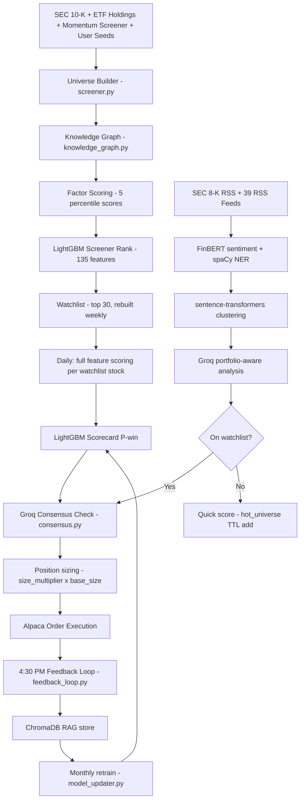

# System Architecture

## Full Pipeline



## Component Map

| Component | File | Role |
|---|---|---|
| Universe builder | `data/screener.py` | 4-method universe (KG + baskets + momentum + seeds) |
| Knowledge graph | `data/knowledge_graph.py` | NetworkX SEC 10-K supply-chain graph |
| Percentile utils | `data/percentile_utils.py` | stock_percentile(), sector_percentile() |
| Hot universe | `data/hot_universe.py` | Thread-safe TTL cache for catalyst-driven additions |
| EDGAR monitor | `data/edgar_monitor.py` | 8-K + Form 4 real-time monitoring |
| News aggregator | `data/news_aggregator.py` | 39 RSS feeds + FinBERT scoring |
| News intelligence | `data/news_intelligence.py` | sentence-transformers + Groq portfolio analysis |
| News relevance | `data/news_relevance_engine.py` | spaCy NER + company→ticker mapping |
| LightGBM model | `strategy/meta_model.py` | Scorecard versioning + load/save |
| Training pipeline | `strategy/training_pipeline.py` | Walk-forward CV, feature engineering |
| Consensus layer | `strategy/consensus.py` | ML+LLM STRONG_BUY/BUY/CONFLICT/SKIP |
| Chart patterns | `strategy/chart_pattern_detector.py` | YOLOv8 16-pattern detector |
| Pattern API | `strategy/pattern_api.py` | Chart generation + inference wrapper |
| Feedback loop | `data/feedback_loop.py` | Daily 4:30 PM mover collection |
| Model updater | `data/model_updater.py` | Monthly 4-filter retrain |
| Fincept data | `data/fincept/` | yfinance, FRED, SEC, CBOE, CFTC modules |
| AI agents | `data/fincept/agents/` | Groq portfolio/risk/signal agents |
| FastAPI server | `server/api.py` | 40+ REST endpoints |
| Dashboard | `dashboard/index.html` | Main trading dashboard |
| Terminal | `dashboard/terminal.html` | Bloomberg-style research terminal |

## Data Sources (all free)

| Source | What | Used by |
|---|---|---|
| yfinance | Quotes, OHLCV, fundamentals | screener, factor scoring, terminal |
| FRED | GDP, CPI, UNRATE, DFF, yields | macro strip, FRED sparklines |
| SEC EDGAR JSON | Filings, Form 4 insider trades | sec_data.py, edgar_monitor |
| CFTC weekly CSV | COT positioning for 10 contracts | cftc_data.py, COT tab |
| TradingView screener | Momentum expansion | tv_screener.py, feedback_loop |
| 39 RSS feeds | News from major financial outlets | news_aggregator.py |
| Alpaca NewsDataStream | Real-time news WebSocket | news_stream.py |
| finvizfinance | ETF holdings for theme baskets | screener.py |
| Groq API | Llama 3.3 70B (free tier) | consensus, news analysis, agents |

## Model Versioning

```
models/
  scorecard_v1.pkl       ← initial model
  scorecard_v2.pkl       ← after monthly retrain
  scorecard_meta.json    ← active version + history
```

`scorecard_meta.json` tracks `active_version`, per-version metrics, rollback availability.
Auto-rollback if new walk-forward accuracy < previous version. Last 3 versions kept.

## Cadence

| Frequency | Task |
|---|---|
| Always-on | News stream, EDGAR 8-K monitor |
| Every 5 min | TradingView screener, RSS feeds |
| Daily 9:30 AM | Signal scoring for watchlist |
| Daily 4:30 PM | Feedback loop (top-mover analysis) |
| Weekly Sunday | Universe rebuild, watchlist update |
| Monthly 1st Sunday | `python -m data.model_updater` |
| Quarterly | Manual deep audit, prompt review |
