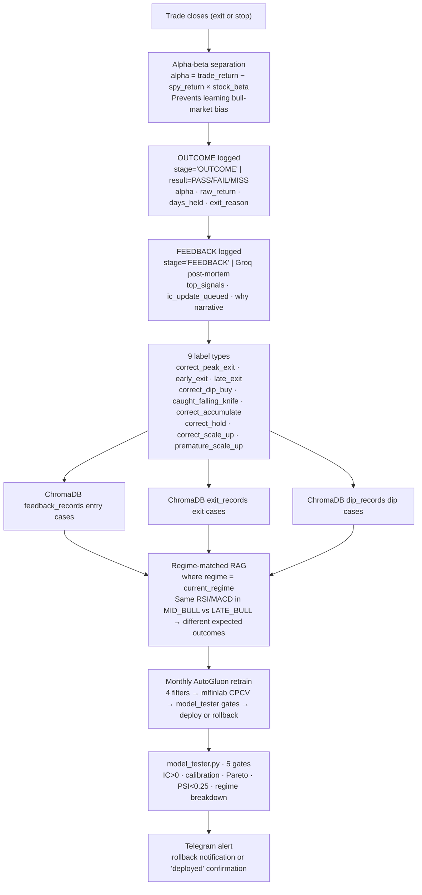

# Feedback Loop + Model Self-Improvement (v14)

## Overview

The feedback system closes the learning loop between live/paper trades and model retraining. Every stage is logged to `trade_lifecycle.db` — human-readable `why` fields let the operator audit any decision without SSH.



---

## Daily Feedback Collection (4:30 PM)

### What it does

1. Fetches top-20 movers of the day (TradingView screener → yfinance fallback)
2. Loads today's watchlist + open positions + signals
3. For each mover, classifies outcome:

**Entry labels (existing):**
- `true_positive` — we held it and it went up
- `false_positive` — we signalled BUY, it went down
- `true_negative` — we passed, it went down (correct skip)
- `missed` — >5% mover not in our watchlist
- `neutral` — within normal variance

**Exit labels (v13 new):**
- `correct_peak_exit` — we sold near the high
- `early_exit` — we sold and it kept going up significantly
- `late_exit` — we held past the peak, gave back gains

**Dip labels (v13 new):**
- `correct_dip_buy` — we bought the dip, it recovered
- `caught_falling_knife` — we bought the dip, it kept falling
- `correct_accumulate` — we added on a dip and it was the right call

**Tranche labels (v13 new):**
- `correct_scale_up` — T2/T3 add was correctly timed
- `premature_scale_up` — added early, position went against us

4. **Alpha-beta separation** applied to every record:
```python
alpha = trade_return - (spy_return_same_period * stock_beta)
# We store alpha, NOT raw return
# A +12% return when SPY was up 10% and beta=1.5 → alpha = +12% - (10% × 1.5) = −3%
# That trade lost to the market, even though it was nominally "green"
```

5. Fetches 3 recent headlines per mover → passes to Groq: "Was this move repeatable? What catalyst?"

6. Persists to:
   - `logs/feedback_loop.jsonl` — human-readable audit trail
   - ChromaDB `feedback_records` — entry cases (existing)
   - ChromaDB `exit_records` — exit cases (v13 new)
   - ChromaDB `dip_records` — dip cases (v13 new)

### Running manually

```bash
python -m data.feedback_loop         # run immediately
python -m data.feedback_loop --dry   # print records without saving
```

---

## RAG — Regime-Matched Queries

**Critical v13 change:** RAG queries MUST include regime filter.

```python
# WRONG (v12): matches any past case with similar technicals
past_cases = chromadb.query(embedding=current_composite, n_results=3)

# CORRECT (v13): regime-matched
past_cases = chromadb.query(
    embedding=current_composite,
    where={"regime": {"$eq": current_regime}},  # must match
    n_results=3
)
```

Why: the same RSI/MACD/momentum pattern in MID_BULL and LATE_BULL produces different outcomes. Mixing regimes in RAG retrieval contaminates the prompt context.

---

## Monthly Model Update (first Sunday of month)

### 4-filter noise removal (applied in order)

| Filter | Rule | Reason |
|--------|------|---------|
| 1. Frequency | catalyst_type must appear ≥ 3 times | Removes one-off anomalies |
| 2. Outlier | Exclude moves > 3 sigma | Removes meme events and squeezes |
| 3. Regime | Only samples from same HMM regime as today | Prevents regime-mismatch contamination |
| 4. Fundamental | Groq confirms repeatable catalyst | Removes noise-driven moves |

### After filtering

```
AutoGluon retrains on filtered + alpha-labeled dataset
mlfinlab CPCV: honest IC ~54% (not inflated ~57% from naive CV)
Validate: IC must be > 0 → if not, rollback to previous model
Save: models/scorecard_entry_v{N+1}.pkl + models/scorecard_exit_v{N+1}.pt
Telegram: "Entry model retrained — IC: 0.142 (+0.008). 847 new samples."
Human-readable report: logs/model_update_reports/YYYY-MM-DD.json
```

### Running manually

```bash
python -m data.model_updater              # full update
python -m data.model_updater --dry        # print plan without retraining
python -m data.model_updater --force      # skip Groq fundamental check (faster)
```

---

## ChromaDB Collections

| Collection | Records | Queried by |
|-----------|---------|------------|
| `feedback_records` | Entry cases · composite + outcome + regime | ConsensusEngine (entry) |
| `exit_records` | Exit cases · exit_score + outcome | ExitMonitor verdict |
| `dip_records` | Dip cases · dip_score + outcome | DipDetector verdict |

All collections are queried with `where={"regime": {"$eq": current_regime}}`.

---

## Invariants

- Alpha labels used for training, not raw returns — bull-market luck is subtracted out
- Prompt updates are **manual only** — never automatic
- Human-readable report is reviewed before any deployment
- False positives tracked alongside winners — no survivorship bias
- Conflict signals separately logged: `logs/consensus_conflicts.jsonl`
- IC must remain > 0 before any model version is deployed (auto-rollback otherwise)
