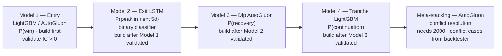

# Scorecard + Decision Models (v13)

## Overview

v13 replaces the single LightGBM scorecard with a **4-model stack** trained sequentially.
Build and validate in order — if entry model has no real edge (IC ≤ 0), nothing built on top has edge either.



---

## Model 1 — Entry (LightGBM / AutoGluon)

**Purpose:** P(win) — will this position reach the profit barrier before the loss barrier?

**Algorithm:** AutoGluon auto-selects best model (typically LightGBM or ensemble). ONNX export for 3–5× faster inference.

**Features (~138 total):**
- 130 technical indicators + 60 CDL patterns (pandas-ta)
- 8 factor scores (0–1 normalised, IC-weighted)
- Algebraic pattern signals (12 patterns from pattern_detector.py)
- 4H trend gate: `int(EMA_50_4H > EMA_200_4H)` ← paradigm-agnostic Sharpe lift
- 1D regime slope: `sign(EMA_200_1D[-1] − EMA_200_1D[-20])` (+1 bull / −1 bear / 0 flat)
- Regime encoding (8-state HMM)
- FinBERT sentiment + headline velocity
- Threat level encoding

**Labels:** Alpha-adjusted triple-barrier:
- +1 = hit profit barrier (TP = 2.0×ATR)
- −1 = hit loss barrier (SL = 1.5×ATR)
- 0  = timeout (20 days)
- Label stored as `alpha = trade_return − (spy_return × stock_beta)` to prevent bull-market bias

**Validation:** mlfinlab CPCV (purged cross-validation):
- Standard k-fold leaks future information in financial time series
- CPCV removes training observations whose labels overlap with test period
- Honest accuracy: ~54% real-world (vs ~57% naive CV — don't use naive CV numbers)

**Threshold:**
```
P(win) ≥ 0.65  → full composite-sized position (don't override composite — multiply)
P(win) 0.52–0.65 → half composite-sized position
P(win) < 0.52  → position_size × 0.25 (still trade, just very small)
```

Note: P(win) is a SIZE multiplier, not a gate. The only hard gates are CRASH regime and cash < 10%.

---

## Model 2 — Exit LSTM Binary Classifier

**Purpose:** P(peak in next 5 days) — NOT a price forecaster.

**Why LSTM not N-BEATS:**
- N-BEATS = time series forecaster (predicts future price values)
- Our exit question = "Is THIS a peak?" → binary classification
- LSTM directly outputs P(peak) with no error-propagating forecast step

```python
class ExitLSTM(nn.Module):
    def __init__(self):
        self.lstm = nn.LSTM(input_size=5, hidden_size=64, num_layers=2, batch_first=True)
        self.classifier = nn.Linear(64, 1)

    def forward(self, x):
        # x: [batch, 30, 5]  — 30-day sequence of [RSI, MACD, vol_ratio, momentum, price_return]
        _, (h, _) = self.lstm(x)
        return torch.sigmoid(self.classifier(h[-1]))
```

**Position-aware features** (appended to LSTM output before final classification):
- `unrealized_pnl_pct` — how much in profit?
- `peak_drawdown_pct` — how much off the high while holding?
- `days_held` — time in trade
- `entry_composite_score` — how confident was the entry signal?
- `finbert_delta_since_entry` — has news sentiment improved or worsened?
- `analyst_downgrade_since_entry` — any rating downgrades?
- `insider_sell_since_entry_usd` — executive selling post-entry?
- `regime_changed_since_entry` — have we moved from MID_BULL to LATE_BULL?

**Exit thresholds:**
```
exit_score ≥ 0.65  →  E1 partial: sell 20–50% via Haiku exit_verdict()
exit_score ≥ 0.75  →  E2 partial: sell 30–80% of remaining
exit_score ≥ 0.88  →  E3 full exit
Core hold:         →  10–20% kept if long-term conviction intact
```

---

## Model 3 — Dip Detector (AutoGluon)

**Purpose:** P(recovery) — is this a buying dip or a falling knife?

**Features:**
- `drop_pct_from_high` — magnitude of the dip
- `drop_speed_days` — how fast did it fall? (crash vs drift)
- `regime` — dips in MID_BULL have higher recovery rate
- `finbert_delta_since_drop` — is news getting worse or stabilising?
- `news_cause_classification` — macro/sector/company-specific?
- `eps_beat_streak` — is the underlying business intact?
- `institutional_ownership_change` — are institutions buying or selling?
- `insider_activity_post_drop` — executives buying own stock?
- `quality_score` — is this fundamentally a good business?
- `pre_drop_rsi` — was it overbought before the drop?
- `options_score` — are calls being bought into the dip?

**Output:**
```
dip_score ≥ 0.65  →  dip_verdict: "buy_dip" or "accumulate"
                      size = 0.8–1.5× T1 (larger because price is lower)
dip_score < 0.65  →  dip_verdict: "avoid"
```

---

## Model 4 — Tranche Scale-Up (LightGBM)

**Purpose:** P(continuation) — should we add to a winning position?

**Features:** current unrealised P&L, momentum confirmation, composite_score, available capital, current tranche level, regime, days since T1 entry

**Output:**
```
tranche_score ≥ regime_threshold  →  add T2 or T3
tranche_score < threshold         →  hold current tranches
```

---

## AutoGluon Training

```python
from autogluon.tabular import TabularPredictor

predictor = TabularPredictor(label='alpha_label').fit(
    train_data,
    presets='best_quality',   # tries 22+ models, ensembles winners
    time_limit=3600,
)
predictor.export_onnx(...)   # 3–5× faster inference
```

AutoGluon auto-selects: typically LightGBM, CatBoost, XGBoost, or ensemble.
No hyperparameter tuning needed — AutoGluon handles it.

---

## IC Tracking

After each trade closes:
```python
IC[signal][regime] = spearman_correlation(
    signal_confidence_scores_at_entry,
    alpha_outcomes
)
# Stored in models/scorecard_meta.json
# Rolling 90-day window, updated per regime
# In LATE_BULL: exit model IC high → upweight exit signals
# In MID_BULL: news model IC high → upweight news signals
```

---

## Versioning + Rollback

```
models/
  scorecard_entry_v1.pkl   ← current entry model
  scorecard_exit_v1.pt     ← current exit LSTM
  scorecard_meta.json      ← active versions + IC history

Auto-rollback: if new model IC < previous → revert to previous version
Human-readable report: logs/model_update_reports/YYYY-MM-DD.json
```
