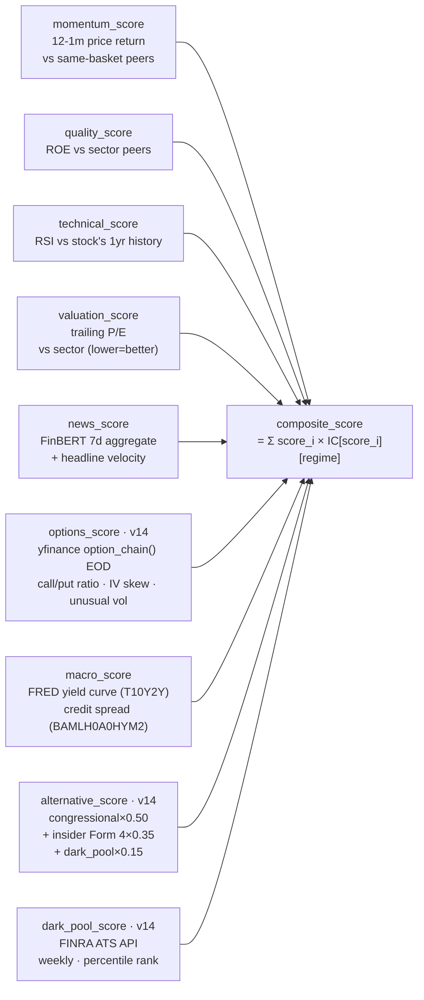

# Universe Screener (v14)

## Philosophy

`data/screener.py` builds the candidate universe using 4 parallel discovery methods, then scores each candidate with **10 factor scores** (all 0–1 normalised) that feed the signal orchestrator as IC-weighted inputs.

**v14 changes:** `options_score` now uses `yfinance.option_chain()` (replaces Unusual Whales Playwright). `alternative_score` replaces `insider_score` — a weighted composite of congressional (0.50), Form 4 insider (0.35), and FINRA dark pool (0.15). Each symbol evaluation is assigned a `trace_id` and logged to `logs/trade_lifecycle.db` as stage `FACTOR_SCORES`.

The screener does NOT eliminate stocks — it scores them. The composite score drives position size.

## Universe Building (4 methods, run in parallel)

### Method 1: Knowledge Graph Expansion
- User seeds → 1–2 hops through the SEC 10-K supply-chain graph
- Discovers ALAB/APLD because NVIDIA mentions them as suppliers in its 10-K
- Source: `data/knowledge_graph.py` (NetworkX, SEC 10-K regex extraction)

### Method 2: Theme Baskets
- 10 pre-defined baskets: AI infrastructure, cloud, crypto, financials, energy, consumer, healthcare, defence, staples, metals
- Each basket → top-50 ETF holdings via finvizfinance
- Ensures cross-sector diversification

### Method 3: Momentum Expansion
- Any US stock with >40% 3-month return, >$5 price, >200k avg volume
- Source: TradingView screener (falls back to yfinance)
- Catches breakout names before mainstream coverage

### Method 4: User Seeds
- `config.json` → `watchlist.mandatory` and `watchlist.manual_additions`
- Congressional buy → auto-adds to candidate pool via insider_score signal

## 10 Factor Scores (all 0–1 normalised)

**v13:** scores moved from 0–100 to 0–1. 0.5 = neutral / missing data.
**v14:** `options_score` source changed; `alternative_score` added; `dark_pool_score` added.



### Score Details

| Score | Source | Neutral | Range | Notes |
|-------|--------|---------|-------|-------|
| `momentum_score` | yfinance returns | 0.5 | 0–1 | Percentile vs same basket peers |
| `quality_score` | yfinance ROE | 0.5 | 0–1 | Percentile vs sector |
| `technical_score` | pandas-ta RSI | 0.5 | 0–1 | vs stock's own 1yr RSI history |
| `valuation_score` | yfinance P/E | 0.5 | 0–1 | Lower P/E = higher score |
| `news_score` | FinBERT + velocity | 0.5 | 0–1 | 7d aggregate + rate-of-change |
| `options_score` | yfinance `option_chain()` | 0.5 | 0–1 | **v14**: EOD call/put ratio, IV skew, unusual vol |
| `macro_score` | FRED API | 0.5 | 0–1 | Shared across all symbols in batch |
| `insider_score` | Congressional (kept for compat) | 0.5 | 0.3–0.8 | v13 key; see `alternative_score` for v14 |
| `alternative_score` | Congressional + Form 4 + Dark Pool | 0.5 | 0–1 | **v14**: cong×0.50 + insider×0.35 + dark×0.15 |
| `dark_pool_score` | FINRA ATS API (weekly, free) | 0.5 | 0–1 | **v14**: percentile rank of dark pool % vs universe |

### IC Weighting

Each score's weight is `IC[score][regime]` = Spearman correlation between past score values and future alpha outcomes, computed per regime window on a rolling 90-day basis.

```python
# In MID_BULL: news_score IC might be highest → it gets most weight
# In LATE_BULL: insider_score IC typically highest → accumulate before execs sell
composite_score = Σ(score_i × IC[score_i][current_regime])
```

## Insider Score Detail

**Congressional trades** (highest empirical IC of any alternative data):

```
Recency weights:
  < 30 days since disclosure:  1.0×
  30–60 days:                  0.5×
  60–90 days:                  0.2×

Amount weight:
  min(amount_mid / $250,000, 3.0) × 0.2

Buy ratio → score:
  buy_ratio in [0, 1] → maps to [0.3, 0.8]
  0.5 = neutral (no trades or perfectly mixed)
  > 0.5 = net buying (bullish signal)
  < 0.5 = net selling (bearish signal)
```

Sources (with fallback):
1. CapitolTrades aggregator (both chambers, free)
2. Senate EFTS (official Senate disclosures)
6-hour file cache. No API key required.

## `_neutral_scores()` (all 0.5)

When any data source fails, the caller falls back to neutral defaults:
```python
{
    "momentum_score":  0.5,
    "quality_score":   0.5,
    "technical_score": 0.5,
    "valuation_score": 0.5,
    "news_score":      0.5,
    "options_score":   0.5,
    "macro_score":     0.5,
    "insider_score":   0.5,
}
```

Neutral scores don't block trades — they contribute 0.5 to the weighted composite. The system always trades; neutral signals size down, not stop.
